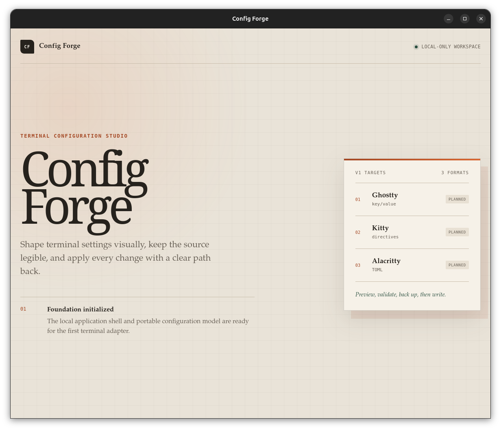

# Config Forge

Config Forge is a local-first Linux desktop application for creating,
importing, previewing, validating, translating, backing up, and safely applying
Ghostty, Kitty, and Alacritty configurations.



## What it does

- **Create or import** a config. Imports keep comments, ordering, unknown
  settings, includes, and malformed lines, so a round trip never silently drops
  content you wrote by hand.
- **Edit visually** (typography, colors, cursor, behavior) or edit the native
  source directly. A mock terminal preview shows the result; it never executes
  commands.
- **Validate** with built-in checks and, when the terminal is installed, the
  terminal's own validator.
- **Translate** a project to another terminal. The source project is not
  changed and a report lists every portable setting as exact, approximate,
  omitted, or defaulted.
- **Apply safely** to a config file: validate, review a diff, snapshot the
  project, back up the existing file, replace it atomically, and read the result
  back. Nothing is written until you confirm the diff.
- **Export** a copy to a new file, keep **named snapshots**, and **restore** any
  snapshot. Restoring snapshots your current state first.
- Start from eight built-in **templates** or save your own.

## Supported terminals

| Terminal  | Format      | Default config path                  |
| --------- | ----------- | ------------------------------------ |
| Ghostty   | key = value | `~/.config/ghostty/config`           |
| Kitty     | key value   | `~/.config/kitty/kitty.conf`         |
| Alacritty | TOML        | `~/.config/alacritty/alacritty.toml` |

`XDG_CONFIG_HOME` is respected. Detected paths are suggested in the Apply panel;
you always choose the destination.

## Linux prerequisites

- Node.js 20.19+ or 22.12+ and npm.
- Rust stable.
- The Linux packages from the
  [Tauri prerequisites guide](https://v2.tauri.app/start/prerequisites/).

On Ubuntu or Debian:

```bash
sudo apt update
sudo apt install -y \
  libwebkit2gtk-4.1-dev \
  build-essential \
  curl \
  wget \
  file \
  libxdo-dev \
  libssl-dev \
  libayatana-appindicator3-dev \
  librsvg2-dev
```

## Development

```bash
npm install
npm run tauri dev   # desktop shell with persistence
npm run dev         # frontend only on port 1420 (session drafts, no database)
```

The browser-only mode has no database: drafts live in memory and Save/Apply
stay disabled. Use the desktop shell for the full workflow.

## Running tests

```bash
npm run format:check
npm run lint
npm run typecheck
npm test                       # Vitest
npx playwright install chromium   # once
npm run test:e2e               # Playwright, desktop + Pixel 5
cargo test --manifest-path src-tauri/Cargo.toml
cargo fmt --manifest-path src-tauri/Cargo.toml -- --check
cargo clippy --manifest-path src-tauri/Cargo.toml --all-targets -- -D warnings
```

The Playwright specs drive desktop-only flows through an in-memory stand-in for
the Rust backend (`tests/e2e/support/tauri-mock.ts`). Real write safety (backup
before replace, failure injection, symlinks, no shell) is covered by the Rust
integration tests in `src-tauri/tests/safe_apply.rs`. If the Chromium build on
disk differs from the one Playwright pins, set
`PLAYWRIGHT_CHROMIUM_EXECUTABLE` to its path.

## Building packages

```bash
npm ci
npm run build
npm run tauri build -- --bundles appimage,deb
```

Artifacts are written under `src-tauri/target/release/bundle/appimage/` and
`src-tauri/target/release/bundle/deb/`. See `CHANGELOG.md` for what has and has
not been verified for release.

## Privacy: local only

Config Forge makes no network requests during normal use. The app has no
telemetry, update checker, or remote content, and its content security policy
only allows resources from the app itself. The shell and filesystem Tauri
plugins are not registered, so the interface can only reach the commands listed
in `src-tauri/src/lib.rs`. The only programs it ever runs are the Ghostty, Kitty,
or Alacritty binary found on your `PATH`, with fixed validation arguments and no
shell.

## Where your data lives

Everything is under the Tauri app-data directory, normally
`~/.local/share/com.configforge.desktop/`:

| Path                               | Contents                                             |
| ---------------------------------- | ---------------------------------------------------- |
| `config-forge.sqlite3`             | Projects, snapshots, and personal templates (SQLite) |
| `backups/<terminal>/<project-id>/` | Timestamped `.bak` copies made before each apply     |
| `exports/`                         | Default location offered for exports                 |
| `staging/`                         | Temporary candidate files for native validation      |

Backups are never deleted by Config Forge, and uninstalling the package leaves
this directory in place.

## Recovery

See [docs/recovery.md](docs/recovery.md). In short: every apply leaves a backup
of the previous file in `backups/`, so copying it back over your config restores
it; any project can also be rolled back from its **History** panel.

## Known limitations

- Linux only. The AppImage and Debian packages are built by CI; clean-account
  install smoke tests have not been run by the maintainers.
- Native validation depends on each terminal's CLI; when it is missing or has no
  safe validation mode, only the built-in checks run and the app says so.
- The destination check before replacing a file is not a filesystem lock: an
  edit by another program in the instant between the check and the rename can
  still be overwritten (the backup holds the previous content).
- Files reached through a symbolic link are refused rather than followed; point
  Config Forge at the real file.
- Translation covers the portable subset only. Terminal-specific settings stay
  with their project and are not carried to another terminal.
- Source editing uses a plain textarea (no syntax highlighting).

## License

GPL-3.0-only. See `LICENSE` and `THIRD_PARTY_NOTICES.md`.

## More documentation

- [docs/architecture.md](docs/architecture.md)
- [docs/adapter-authoring.md](docs/adapter-authoring.md)
- [docs/recovery.md](docs/recovery.md)
- [docs/project-status.md](docs/project-status.md)
- [docs/config-forge-implementation-plan.md](docs/config-forge-implementation-plan.md)
